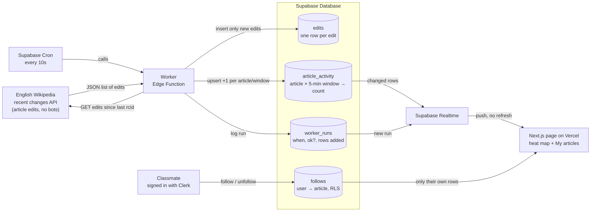

# Data Flow

How an edit on English Wikipedia ends up on someone's screen. Drawn before any code was written.

## What each part sends to the next

| From → To | What's sent |
|---|---|
| Cron → Worker | An HTTP call every 10 seconds |
| Worker → Wikipedia | `list=recentchanges`, namespace 0, no bots, edits newer than the last saved `rcid` |
| Wikipedia → Worker | Up to 500 edits: `rcid`, `title`, `user`, `timestamp`, `oldlen`/`newlen` |
| Worker → `edits` | Only edits whose `rcid` isn't stored yet |
| Worker → `article_activity` | Upsert: +n for each (article, 5-minute window) that got new edits |
| Worker → `worker_runs` | One row per run: started at, ok or error, rows changed |
| Realtime → Page | Changed `article_activity` rows and new `worker_runs` rows |
| Page ↔ `follows` | The signed-in user's own follows only, enforced by row-level security |

## Tracing one update

Someone edits "Rhode Island". Within 10 seconds Cron calls the worker. The worker asks Wikipedia
for edits newer than the last one it saved, gets that edit back, inserts it into `edits`, and adds
1 to Rhode Island's count for the current 5-minute window. Realtime pushes the changed row to every
open page and that heat map cell gets darker. If you follow Rhode Island, "My articles" updates too.

## Freshness states

Driven by the latest row in `worker_runs`:

- **Loading:** no data yet.
- **Fresh:** last successful run within ~30 seconds ("Updated 4s ago").
- **Stale:** last successful run older than ~30 seconds, meaning several runs were missed.
- **Down:** the last run failed.

## What breaks if a part changes

- **Wikipedia renames a field** (`rcid`, `title`): the worker saves nothing or errors, so the page shows **down**.
- **Cron stops calling the worker:** no new runs, so the page shows **stale**.
- **Realtime setup is incomplete** (table not in the publication, no read grant, or no RLS policy): the page silently receives nothing.
- **Clerk user id format changes:** RLS on `follows` stops matching, and people can't see their follows.
